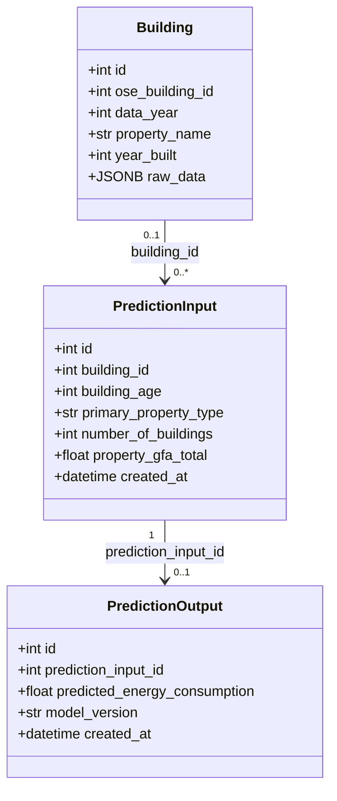

# Architecture du projet

## Diagramme de classes UML

## Description des composants

### API FastAPI

L'API expose les routes `/`, `/health` et `/predict`.

La route `/predict` valide les données avec Pydantic,
enregistre les paramètres dans PostgreSQL, exécute
le modèle de prédiction et enregistre le résultat.

### Modèle Machine Learning

Le modèle Scikit-learn est chargé depuis un fichier
Joblib par le service de prédiction.

### Base de données PostgreSQL

La base contient trois tables principales :

- `buildings` : données des bâtiments.
- `prediction_inputs` : paramètres des prédictions.
- `prediction_outputs` : résultats des prédictions.

SQLAlchemy assure la correspondance entre les classes
Python et les tables PostgreSQL.

### Tests automatisés

Pytest vérifie les routes, la validation des données,
la gestion des erreurs et les opérations PostgreSQL.

GitHub Actions exécute les tests unitaires et
d'intégration avec une base PostgreSQL temporaire.
Le seuil minimal de couverture est fixé à 85 %.
